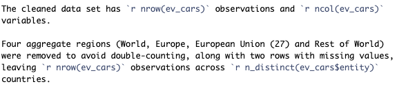

```{css, echo = FALSE}
body { font-size: 12px; }
pre, code { font-size: 10px; }
h2 { font-size: 16px; margin-top: 10px; }
h3 { font-size: 14px; }
h1.title { font-size: 24px; margin-top: 8px; margin-bottom: 4px; }
h4.author, h4.date { font-size: 12px; margin: 2px 0; }
```

```{r setup, include=FALSE}
knitr::opts_chunk$set(echo = TRUE, fig.align = "center")
```
## Loading Libraries
```{r Libraries, echo = FALSE, message = FALSE, warning = FALSE}
library(readr)
library(dplyr)
library(tidyr)
library(ggplot2)
library(knitr)
library(bookdown)
```

## Research Question
Which countries sold the most electric cars between 2010 and 2025, and how does this compare with their overall car sales? Overall car sales are defined as the total of electric and non-electric car sales.

## Data Set Introduction
This report uses [Number of new cars sold, by type](https://ourworldindata.org/grapher/car-sales), which records the number of new electric and non-electric cars sold between 2010 and 2025 across 60 countries. This data originates from the International Energy Agency's *Global EV Outlook 2025*, processed by Our World in Data (OWID).
```{r load-data}
ev_cars <- read_csv("Data/car-sales.csv", show_col_types = FALSE) %>%
  rename(entity = Entity,
         code = Code,
         year = Year,
         electric_cars = 'Electric cars',
         non_electric_cars = 'Non-electric cars') %>%
  filter(!entity %in% c("World", "Europe", "European Union (27)",
                        "Rest of World")) %>%
  drop_na()
```
There are 5 variables: the two character variables are entity (the country of sale) and code (its three-letter country code). The three numeric variables are year (the calendar year of the record), electric_cars and non_electric_cars (the number of new electric and non-electric cars sold in that country and year).
```{r variable-table}
variable_table <- data.frame(Variable = names(ev_cars),
                            Type = sapply(ev_cars,class))
kable(variable_table,
      row.names = FALSE,
      caption = "Variables in the car data set")
```

## Data Set Description
The cleaned data set has `r nrow(ev_cars)` observations and `r ncol(ev_cars)` variables. Four aggregate regions (World, Europe, European Union (27) and Rest of World) were removed to avoid double-counting, along with two rows with missing values, leaving `r n_distinct(ev_cars$entity)` countries.
```{r code-screenshot, out.width = "55%"}

```

```{r structure}
str(head(ev_cars, 2))
```
## Data Summary
```{r summary-table}
ev_summary <- ev_cars %>%
  select(entity, electric_cars, non_electric_cars) %>%
  group_by(entity) %>%
  summarise(mean_electric = mean(electric_cars),
            total_electric = sum(electric_cars),
            mean_non_electric = mean(non_electric_cars),
            total_non_electric = sum(non_electric_cars)) %>%
  arrange(desc(total_electric)) %>%
  head(6)

kable(ev_summary,
      digits = 0,
      format.args = list(big.mark = ","),
      caption = "Top countries by total electric car sales between 2010 and 2025")

```
**China**, followed by the United States and then Germany, sold the most electric cars between 2010 and 2025. However, even in China, electric sales (46.6 million) are far below non-electric sales (272.7 million), and Norway is the only country shown where the two are close. 

```{r share-table}
share_table <- ev_summary %>%
  mutate(electric_share = 100 * total_electric/
           (total_electric + total_non_electric)) %>%
  select(entity, electric_share)

kable(share_table,
      digits = 1,
      col.names = c("Country", "Electric share of total sales (%)"),
      caption = "Percentage of Electric Sales during 2010 to 2025")

```

Table \@ref(tab:share-table) expresses each country's electric sales as a percentage of its overall car sales (electric plus non-electric) from 2010 to 2025. Norway's share is by far the highest of the six countries, at 48.0%, while China, despite having the most electric sales, reaches only 14.6%.

## Visualisations 
```{r scatter plot, fig.cap = "Total electric and non-electric car sales by country, 2010 to 2025", fig.height = 3, fig.width = 4.5, out.width = "55%"}
country_totals <- ev_cars %>%
  group_by(entity) %>%
  summarise(total_electric = sum(electric_cars),
            total_non_electric = sum(non_electric_cars))

ggplot(data = country_totals,
       aes(x = total_non_electric, y = total_electric)) +
  geom_point(alpha = 0.7) +
  geom_text(data = filter(country_totals,
                          entity %in% c("China", "United States", "Norway")),
            aes(label = entity),
            hjust = 1.15,
            size = 3) +
  scale_x_log10(labels = scales::comma) +
  scale_y_log10(labels = scales::comma) +
  labs(x = "Total non-electric cars sold (log scale)",
       y = "Total electric cars sold (log scale)")
```

- *Countries with larger non-electric car sales generally also have larger electric car sales, so the points are upward sloping.*

- *China sits at the top right with the highest totals for both, while Norway lies well above the general pattern, with electric sales (1.14 million) close to its non-electric sales (1.23 million)*

## Conclusions
China, the United States and Germany sold the most electric cars between 2010 and 2025. Compared with overall car sales, however, electric cars remain a minority in most of these leading markets, where non-electric sales are far higher. Norway is the exception, with electric sales (1.14 million) close to its non-electric sales (1.23 million). Across all 60 countries, those with larger non-electric sales also tended to sell more electric cars.
